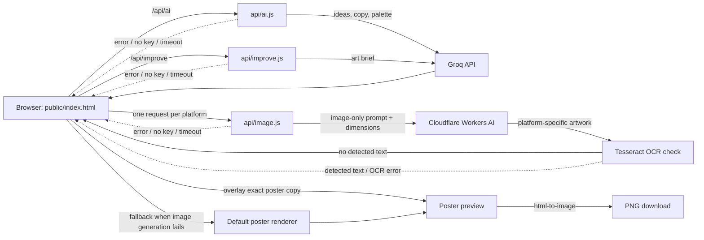

# Shilpam (शिल्पम्) — AI poster studio

Pick a post type, describe the idea (optionally let AI sharpen it), choose a design and platforms, and get fresh Cloudflare artwork with the exact poster copy layered on top for each selected platform. Click any poster to open a full-size preview with zoom controls; PNG export remains a separate action. The app's default poster layout is used if Cloudflare image generation fails.

## 1. Run it on your desktop (VS Code)

1. Install **Node.js 18+** (nodejs.org) and **VS Code**.
2. VS Code → File → Open Folder → the `shilpam` folder (the one containing `package.json`). If you opened its parent folder instead, run `cd .\shilpam` in the terminal first.
3. Terminal (Ctrl + `):
   ```
   npm install
   copy .env.example .env      (Mac/Linux: cp .env.example .env)
   ```
4. Open the `.env` file (it is created for you with empty values) and paste each key after its `=`. Nothing is pre-filled:
   - `GROQ_API_KEY` from console.groq.com: Groq writes ideas, poster copy and colours, and improves your idea.
   - `CLOUDFLARE_API_TOKEN` from Cloudflare Workers AI: use a token with Workers AI Read and Edit permissions.
   - `CLOUDFLARE_ACCOUNT_ID` from your Cloudflare dashboard.
   Restart `npm start` after editing `.env`.
5. `npm start` → open http://localhost:3000 . Check http://localhost:3000/api/health to confirm the Groq and Cloudflare settings are present. On Vercel, check `https://<your-domain>/api/health`. This only checks whether credentials are present; it does not verify them with the providers.

## 2. Artwork (already included)

- `public/assets/mandala.png` — circle cut from your dot-painted mandala: the dot of the "i" and the four corners.
- Border: the original lotus-and-diamond border. Your Madhubani half is saved as `public/assets/border-madhubani.png`; `public/config.js` shows how to switch to it.
- `public/config.js` — crop settings if you swap in other pictures. Use pictures you own or have permission to use.

## 3. Push to GitHub and go live (Vercel)

```
git init
git add .
git commit -m "Shilpam first version"
```
Create an empty repo on github.com and run the two lines it shows (`git remote add origin ...`, `git push -u origin main`).
Vercel → Add New Project → import the repo → Settings → Environment Variables → add `GROQ_API_KEY`, `CLOUDFLARE_API_TOKEN`, and `CLOUDFLARE_ACCOUNT_ID` → Deploy. `GROQ_MODEL` is an optional model override.
`.env` is listed in `.gitignore`, so keys are never pushed. (The file is called `.gitignore`.)

## 4. Groq text and Cloudflare image pipeline

| Step | File | What happens |
|---|---|---|
| 1 | `lib/groq.js` | Groq writes ideas, poster copy, palettes, and an improved idea/art brief. |
| 2 | `lib/platforms.js` | Maps each selected platform to its export size, aspect ratio, and text-safe image composition. |
| 3 | `lib/cloudflare.js` | Builds a text-free image-background prompt that treats the idea as scene guidance, then calls Cloudflare Workers AI with per-platform image dimensions. |
| 4 | `api/image.js` | Generates and OCR-checks each background. If text is detected or the check fails, the whole set uses the default Shilpam layout. The browser overlays copy as real text. |

Edit the wording of the Groq copy prompt in `api/ai.js` and the image-only artwork prompt in `lib/cloudflare.js`.

## 5. Architecture



- **Frontend** (`public/`): one static page. Layouts, text fitting and PNG export run in the browser.
- Click a generated poster to inspect it full size. Use zoom controls, keyboard `+`/`-`, `Fit`, or `Escape` to close; export the PNG with its separate button.
- **Backend** (`api/`, helpers in `lib/`): the only place with keys. Each endpoint accepts a fixed set of fields, builds its own prompt, caps lengths, rate-limits per IP, and checks what comes back.
- **Local server** (`server.js`) serves `public/` and mounts the same `api/` handlers. Vercel runs them as serverless functions.

## 6. Every API / model used

| Service | Used for | Default model | File |
|---|---|---|---|
| Groq API | poster ideas, copy, colour palette, and idea improvement | `openai/gpt-oss-20b` (`GROQ_MODEL`) | `lib/groq.js`, `api/ai.js`, `api/improve.js` |
| Cloudflare Workers AI | image-led platform-specific poster artwork | `@cf/black-forest-labs/flux-2-klein-4b` | `lib/cloudflare.js`, `lib/platforms.js`, `api/image.js` |
| Tesseract.js | local OCR check for accidental lettering in generated images | English OCR | `lib/text-detection.js`, `api/image.js` |
| Google Fonts | typography | – | `index.html` |
| html-to-image 1.11.11 (jsDelivr) | PNG export | – | `index.html` |

The Cloudflare token and account ID are used only by the backend and are never sent to the browser. Groq provides concise poster wording (headline up to 4 words, kicker 2, supporting line 5, CTA 2). Cloudflare is prompted to generate only a scene background; Shilpam overlays its copy as real text. Tesseract.js checks each generated image locally before it reaches the browser; detected lettering or an OCR failure rejects the image set and uses the default Shilpam layout. Prompts request platform-specific generation dimensions, and the browser resizes the full frame to the exact export canvas without cropping. Platform style guidance is prompt-based, not live trend research. Generated poster images are not stored across refreshes.

## 7. If something fails midway

| Failure | What happens |
|---|---|
| No Groq key, quota used up, timeout, 429/5xx on text | built-in wording, palette, and artwork are used, with a small notice |
| Groq fails on "Improve my idea" | your idea stays unchanged; the picture then uses a plain template prompt |
| Cloudflare credentials are missing or any selected platform image fails | the full-image set is discarded and the default Shilpam poster layout is used for the whole set |
| OCR detects lettering in a generated image, or cannot verify it | the full-image set is discarded and the default Shilpam layout is used, avoiding misspelled image text |
| Cloudflare returns 403 | confirm the token is active, has Workers AI Read and Edit permissions, and belongs to the configured Account ID |
| Refresh or closed tab mid-way | progress is restored from localStorage (generated Cloudflare artwork is not stored; generate the poster set again) |
| Font embedding fails during export | export retries without embedded fonts |
| Export library blocked / offline | notice asks for a screenshot |
| Someone spams the endpoints | rate limits (30/min copy, 20/min improve, 6/min pictures per IP) and fixed fields mean your keys cannot be used as a free chatbot |
